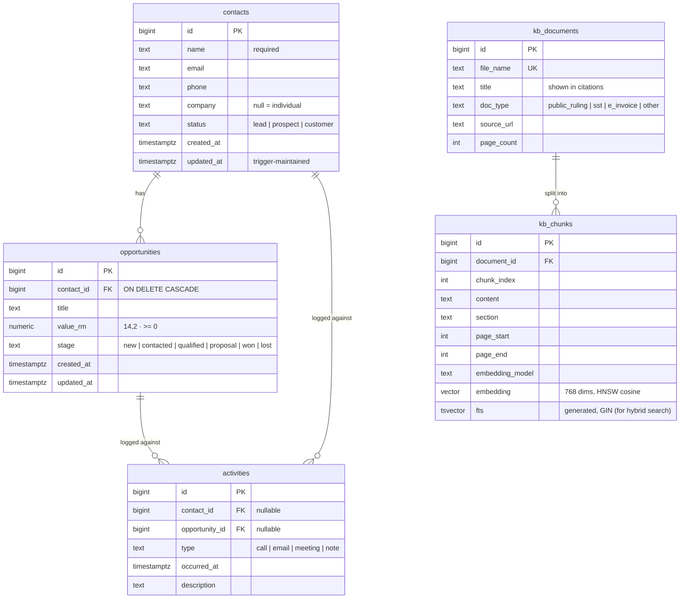

# Architecture

> Lightweight CRM with a RAG-based Malaysian tax document Q&A module.

## Project timeline

Brief received Tue 10 Nov 2026 · Deadline **Sun 15 Nov 2026** (target: submit by midday).

Strategy: RAG is assessed most closely and I am new to Next.js, so the RAG pipeline is built **before** the CRM, while my Day-0 momentum on pgvector is fresh. CRUD for the CRM is commodity work that AI tools accelerate well.

| Day | Date | Goal | Done when | Status |
|---|---|---|---|---|
| 0 | Tue 10 Nov | Learn RAG concepts: embeddings, cosine similarity, chunking, top-k, precision/recall; pgvector + gte-small prototype (`prototype/main.py`) | Can explain RAG end-to-end | ✅ Done |
| 1 | Wed 11 Nov | Knowledge quiz and corrections (`FINDINGS.md`). Next.js fundamentals. Scaffold app, connect Supabase. Component diagram + data model. Ingestion script: parse page-by-page → chunk → embed → insert | 5+ documents in `chunks` with page numbers | ✅ Done Thu 12 Nov AM: 6 docs, 235 chunks. Component diagram + data model carried over to Day 2 |
| 2 | Thu 12 Nov | `match_chunks` SQL function → `/api/ask` route (embed → retrieve → prompt → LLM → citations + refusal guard) → chat UI → eval script, run, tweak one variable, re-run | Cited answer in the browser + eval table | ✅ Done Thu 12 Nov: `/api/ask`, chat UI `/ask`, eval (17 Qs, 350 vs 200-token experiment → 200 adopted) |
| 3 | Fri 13 Nov | CRM: contacts CRUD with search/filter, opportunities grouped by stage, dashboard, minimal activities table | CRM works with seed data | ✅ Done early, Thu 12 Nov evening: contacts, pipeline board, activities, live dashboard; browser-tested |
| 4 | Sat 14 Nov | Bonus (hybrid search or rerank). README, ARCHITECTURE, AI_USAGE. Fresh-clone test | A stranger could run it | ⬜ |
| 5 | Sun 15 Nov | Buffer, screen recording / deploy, **submit by midday** | Email sent | ⬜ |

---

## System component diagram

*TODO*

## Data model

Two independent groups of tables in one Postgres database (Supabase): the **CRM** and the **knowledge base**. They aren't joined. The RAG module answers general tax questions and doesn't read client data.

**Design notes**
- **"Leads" and "contacts" are one table.** The brief uses both words; Lead / Prospect / Customer is a `status` on the contact, not a separate entity. A lead that converts keeps its history.
- **Allowed values are enforced with `CHECK` constraints in the database**, not just in the UI: status, stage, activity type, value ≥ 0, and "an activity must link to a contact or an opportunity". TypeScript constants in `web/lib/crm/types.ts` mirror them.
- **Deletes cascade.** Deleting a contact removes their opportunities and activities. The UI warns with the number of deals that will go.
- **Stage changes are written to `activities`** as notes ("Stage changed: Qualified → Proposal"), so the dashboard feed shows pipeline movement without a separate audit table.
- **Row-level security is on with no policies.** Only the server, using the secret key, can read or write. The brief says no authentication, so the app is a single hardcoded user and the browser never talks to Supabase directly.
- **Indexes** cover the filters and sort orders the pages use (status, stage, contact_id, occurred_at desc). Contact search uses `ILIKE` across name/email/company/phone, which is fine at this size. At scale it would use `pg_trgm` or full-text search.

## RAG design

*TODO — parsing, chunking strategy & size, embedding model, vector store & index, retrieval settings (top-k, filters, reranking), prompt design, citation approach, hallucination guard, error handling.*

## Evaluation results

**Set-up.** [`eval/questions.json`](../eval/questions.json) holds 17 questions: 14 in scope, spread across all 6 documents, each with the expected source PDF and the page numbers where the answer is stated (checked by reading the PDFs), plus 3 out of scope (2 tax-related but not covered, 1 unrelated). [`eval/run_eval.py`](../eval/run_eval.py) runs two modes:
- **Retrieval only** (no LLM): document hit@k, page hit@k (a retrieved chunk from the right document covers an expected page) and MRR.
- **End-to-end** through `/api/ask`: answered vs refused, whether the expected document was cited, and latency.

Raw results for every run are in `eval/results/`.

### Experiment: chunk size 350 → 200 tokens (everything else unchanged)

| Metric (14 in-scope questions) | 350 tokens | **200 tokens** |
|---|---|---|
| Chunks in the index | 235 | 433 |
| Document hit rate @1 / @3 / @5 | 93% / 93% / 93% | **100% / 100% / 100%** |
| Page hit rate @1 / @3 / @5 | 71% / 93% / 93% | **79% / 100% / 100%** |
| MRR (document) | 0.929 | **1.000** |
| End-to-end: answered **and** cited the expected document | 13/14 | **14/14** |
| End-to-end: out-of-scope correctly refused | 3/3 | 3/3 |
| End-to-end: median latency | 6.2 s | 4.1 s |

**Decision:** 200 tokens is now the default (D-005).

### What I learned
1. **Smaller chunks fixed the one retrieval miss, probably for an interesting reason.** "What does PR No. 4/2026 say about hire purchase?" retrieved only chunks from *PR 2/2026* with 350-token chunks. With 200-token chunks the right chunk ranked first. Each chunk is embedded with its document title prepended ("Public Ruling No. 4/2026: …"), and in a shorter chunk that title carries more weight in the vector. The margin is thin, though (0.851 vs 0.845 for the next document), so identifier questions still need hybrid search to be reliable.
2. **Smaller chunks didn't hurt answer quality.** List answers got *more* faithful: the lifestyle-relief answer quotes the ruling's own (a)–(d) list instead of paraphrasing it. Top-5 × 200 tokens is still enough context.
3. **The similarity threshold can't tell scope apart for tax-related questions.** The best out-of-scope score (Singapore GST, 0.846) is within 0.005 of the lowest in-scope score (0.851). No threshold reaches both 100% in-scope passed *and* 100% out-of-scope blocked without overfitting to 17 questions. Guard 1 (0.80) only filters unrelated questions. The LLM's own "not covered" judgement (guard 2) caught every tax-related out-of-scope question. This is why the guards are layered.
4. **Page hit @1 (79%) is lower than document hit @1 (100%).** The right document is always found, but sometimes a neighbouring section ranks above the exact answer page. Top-5 covers it, which is why the LLM still answers correctly.
5. **Faithfulness check:** I read all 14 answers against the source. All were factually correct. One paraphrase was clumsy: "an exclusive working woman" for the source's "exclusively for working women". The meaning is kept, but the wording shows the model rephrases rather than quotes.
6. **Caveat:** 14 in-scope questions is a small set. One question is worth 7 percentage points, so these results show a direction, not a precise measurement.

## Stack choice

*TODO*

## What I would do differently with more time

*TODO*
